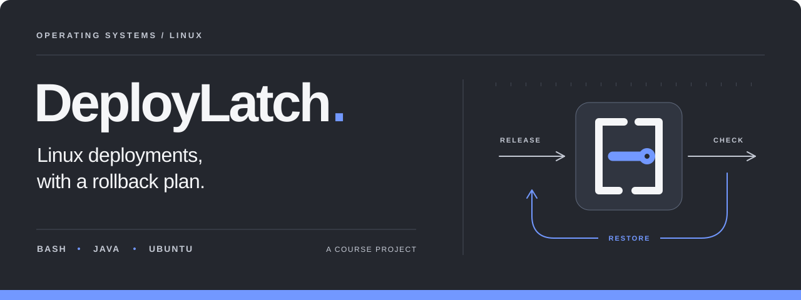
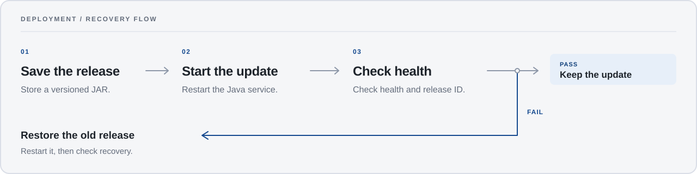

<p align="center">
  <picture>
    <source media="(max-width: 600px)" srcset="docs/assets/deploylatch-banner-mobile.svg">
    
  </picture>
</p>

<p align="center">
  An Operating Systems project on Bash automation, Java services, and deployment recovery.
</p>

<p align="center">
  <sub>Operating Systems &nbsp;·&nbsp; UBIT, University of Karachi</sub>
</p>

<p align="center">
  <a href="#why-this-project">The idea</a> &nbsp;·&nbsp;
  <a href="#the-workflow">Workflow</a> &nbsp;·&nbsp;
  <a href="#inside-the-project">Inside the project</a> &nbsp;·&nbsp;
  <a href="#lets-connect">Connect</a>
</p>


## Why this project

I chose DeployLatch for my Operating Systems course at UBIT, University of Karachi. I wanted the Linux and Bash work to connect with the Java backend development I was learning at the time.

An application still needs to be started, checked, updated, and recovered when something goes wrong. This project gave me a practical reason to work through processes, services, files, permissions, and exit codes around a Java application.

<br clear="right">

## The workflow

The deployment design follows one application on one Ubuntu VM in VMware. Keep the previous version available, start the update, and check its HTTP response. A passing check keeps the update. A failing check sends the workflow back to the previous version, followed by another check to verify recovery.

<p align="center">
  <picture>
    <source media="(max-width: 600px)" srcset="docs/assets/deployment-flow-mobile.svg">
    
  </picture>
</p>


## Inside the project

The Java demo uses the JDK's built-in HTTP server. It listens on `127.0.0.1:8080`, with `GET /health` returning `OK` and `GET /version` returning `v1`. These give the deployment design two things to check: whether the process responds and which version is running.

Bash handles the automation in the design: ordering deployment steps, checking command results, preserving the previous application version, and deciding when to recover. systemd provides the Linux service-management model around the Java process.

<br clear="right">

<details>
<summary><strong>Project structure</strong></summary>

```text
deploylatch/
├── demo-app/src/main/java/dev/deploylatch/demo/
│   └── DemoServer.java
├── docs/assets/
│   ├── tech/
│   └── THIRD_PARTY.md
└── README.md
```

[`DemoServer.java`](demo-app/src/main/java/dev/deploylatch/demo/DemoServer.java) contains the HTTP application. `docs/assets/` holds the README artwork, technology icons, and their source notices.

</details>

<details>
<summary><strong>Tools and responsibilities</strong></summary>

| Tool | Role in the project |
| :--- | :--- |
|  Linux / Ubuntu | Processes, files, permissions, and the target environment |
|  Bash | Deployment control flow and recovery logic |
|  Java / JDK | HTTP application and executable JAR |
| systemd | Service lifecycle and process inspection |
| curl | HTTP response checks |
| VMware | Local Ubuntu environment |
|  Git / GitHub | Version history and project documentation |

</details>

<details>
<summary><strong>Course context and learning</strong></summary>


**Operating Systems · SE-458**<br>
Department of Computer Science, UBIT, University of Karachi.

I started DeployLatch in 2026 as my fourth-semester course project and developed it independently.

The OS work connects shell control flow with process management, file permissions, service behavior, and failure handling. The Java work covers a small HTTP service, response handling, and packaging. Together, they let me study how application code interacts with its Linux environment.

<br clear="right">

</details>

## Let's connect

I'm **Shaikh Mahad Ud Din**, [@codewithmahad](https://github.com/codewithmahad). I build Java backend projects and share what I learn. If you're working with Java or Linux, or want to collaborate on a project, I'd be glad to connect.

<p>
  <a href="https://github.com/codewithmahad"></a>
  <a href="https://www.linkedin.com/in/codewithmahad/"></a>
  <a href="https://shaikhmahad.vercel.app/"></a>
  <a href="mailto:codewithmahad@gmail.com"></a>
</p>
