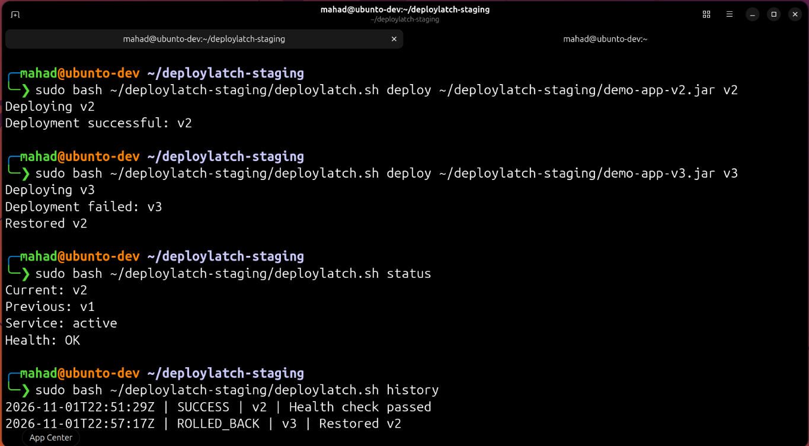
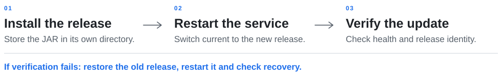

<h1 id="top">
  <picture>
    <source media="(prefers-color-scheme: dark)" srcset="docs/assets/deploylatch-mark-on-dark.svg">
    
  </picture>
  <picture>
    <source media="(prefers-color-scheme: dark)" srcset="docs/assets/deploylatch-title-dark.5d8ff03dd1.svg">
    
  </picture>
</h1>

**A Bash deployment and rollback tool for a Java service on Linux.**

I built DeployLatch for my Operating Systems course at UBIT to practise Linux and Bash alongside Java. It manages **one Java service on one Ubuntu VM**, from installing an update to checking it and recovering if it fails.

<p><strong>Bash &middot; Java &middot; Ubuntu &middot; systemd</strong><br><sub>SE-458 &middot; Fourth semester &middot; UBIT, University of Karachi</sub></p>

<p><a href="#deployment-demo">Demo</a> &nbsp;&middot;&nbsp; <a href="#how-it-works">Workflow</a> &nbsp;&middot;&nbsp; <a href="#run-it">Run it</a> &nbsp;&middot;&nbsp; <a href="#read-the-code">Code</a></p>

## Deployment demo

I tested a working update and automatic recovery on an **Ubuntu VM in VMware**. The three JARs come from one small Java application; v3 deliberately returns HTTP 503 so the recovery path can be demonstrated.

1. **Start with v1.** The service is running and `/health` returns `OK`.
2. **Deploy v2.** The update passes; v1 becomes the manual rollback target.
3. **Attempt v3.** The update fails; v2 is restored and verified.

**[View the terminal demonstration](docs/assets/deployment-demo.png)**

The failed v3 command still returns a non-zero exit status: the requested update failed, even though recovery succeeded.

<details>
<summary><strong>Screenshot and final service status</strong></summary>

<a href="docs/assets/deployment-demo.png"></a>

After recovery:

```text
Current: v2
Previous: v1
Service: active
Health: OK
```

Saved Ubuntu run; click the image to inspect the commands and history at full size.

</details>

## How it works

Each JAR stays in its own release directory. The `current` symbolic link selects the release systemd starts; `previous` identifies the manual rollback target. The Java process runs under a dedicated, non-root account.

<picture>
  <source media="(max-width: 600px) and (prefers-color-scheme: dark)" srcset="docs/assets/release-workflow-mobile-dark.5414e9bd1f.svg">
  <source media="(max-width: 600px)" srcset="docs/assets/release-workflow-mobile-light.0943204efc.svg">
  <source media="(prefers-color-scheme: dark)" srcset="docs/assets/release-workflow-dark.ff58527a0d.svg">
  
</picture>

An update passes only when `/health` returns `OK` and `/version` matches the requested release ID. A file lock prevents overlapping commands, and deployment outcomes are logged with UTC timestamps.

## Run it

The existing setup builds on **Windows with PowerShell and JDK 25**, then runs on **Ubuntu with Java 25, Bash, curl, flock, and systemd**. SSH/SCP copies the prepared files to the VM.

**[Follow the Ubuntu setup guide &rarr;](docs/OPERATIONS.md)** for the build, transfer, initial v1 installation, service account, and troubleshooting.

<details>
<summary><strong>Build the JARs and run the demonstration</strong></summary>

In Windows PowerShell, from the repository root:

```powershell
.\scripts\build-demo.ps1
```

This creates `demo-app-v1.jar`, `demo-app-v2.jar`, and `demo-app-v3.jar` in `demo-app/dist/`. Complete the [initial Ubuntu setup](docs/OPERATIONS.md#4-install-the-initial-release-and-service) before running the commands below.

On Ubuntu, from `~/deploylatch-staging/`:

```bash
sudo bash deploylatch.sh deploy demo-app-v2.jar v2
sudo bash deploylatch.sh deploy demo-app-v3.jar v3
sudo bash deploylatch.sh status
sudo bash deploylatch.sh history
```

After the failed v3 update restores v2, `rollback` selects v1 and makes v2 the new rollback target:

```bash
sudo bash deploylatch.sh rollback
```

Every deployment needs a unique release ID that matches the version packaged in its JAR. Old and failed release directories remain, so repeating the same ID is refused.

</details>

## Read the code

Start with the Bash controller and follow its calls into the service and HTTP checks.

- **[Bash controller](scripts/deploylatch.sh)** &mdash; command handling, release links, verification, recovery, and history.
- **[Service unit](systemd/deploylatch-demo.service)** &mdash; Java startup, service account, and restart behavior.
- **[Java application](demo-app/src/main/java/dev/deploylatch/demo/DemoServer.java)** &mdash; local `/health` and `/version` endpoints.
- **[Build helper](scripts/build-demo.ps1)** &mdash; compile once and package three test releases.

<details>
<summary><strong>Commands, paths, and failure behavior</strong></summary>

The operational commands require sudo and take the same exclusive lock. `help` prints usage without either.

- **`deploy JAR RELEASE_ID`** &mdash; install and verify an update; recover on failure.
- **`rollback`** &mdash; select and verify `previous`; swap the targets on success.
- **`status`** &mdash; show selected releases, service state, and HTTP health.
- **`history`** &mdash; print the latest 20 deployment records.
- **`help`** &mdash; display command usage; no sudo required.

Releases live at `/opt/deploylatch/releases/<id>/app.jar`. The `current`, `previous`, and `.deploy.lock` entries sit under `/opt/deploylatch/`. Outcomes are appended to `/var/log/deploylatch/deployments.log`. For Java startup errors, use `journalctl -u deploylatch-demo.service -n 40 --no-pager`.

- **Verification:** up to eight attempts, with a two-second timeout per HTTP request and a one-second pause after an unsuccessful attempt.
- **Link replacement:** a temporary symlink is renamed over `current`. This makes the pointer change atomic, not the whole deployment.
- **Invalid input:** unreadable files, invalid IDs, and existing release IDs are refused before activation. The file check does not validate JAR contents.
- **Failed update:** restore and verify the old release. If no valid old release exists, attempt to stop the service, remove `current`, and record `FAILED`.
- **Recovery failure:** record `ROLLBACK_FAILED`. A failed manual rollback restores the original pointer and attempts a restart, without another health check of that original release.

Successful operations record `SUCCESS` or `MANUAL_ROLLBACK`; verified automatic recovery records `ROLLED_BACK`. A failed deployment keeps its non-zero exit status.

The Java service binds to `127.0.0.1:8080` and reads its version and health setting from a packaged `release.properties` file. Unknown paths return `404`; non-GET methods on the endpoints return `405`. Both `/version` and healthy `/health` responses use HTTP 200; v3's `/health` returns HTTP 503.

</details>

**Scope:** one service, brief restart downtime, and HTTP-level checks. Paths, port, and retries are fixed. Old releases are retained, and recovery after an interruption or machine failure is not guaranteed.

## What I learned

The project helped me connect permissions, symlinks, locking, and exit codes to a running service. The most useful lesson was checking process state, application health, and release identity separately: an active process can still be unhealthy or running the wrong version.

## Let's connect

I'm [**Shaikh Mahad Ud Din**](https://github.com/codewithmahad). If you're working through Java services or Linux scripting too, I'd be glad to compare approaches. Found a problem? [Open an issue](https://github.com/codewithmahad/deploylatch/issues) with the command you ran and its output.

<p>
  <a href="https://github.com/codewithmahad"></a>
  <a href="https://shaikhmahad.vercel.app/"></a>
  <a href="mailto:codewithmahad@gmail.com"></a>
</p>

<p><sub><a href="docs/assets/THIRD_PARTY.md">Artwork credits</a> &nbsp;&middot;&nbsp; <a href="#top">Back to top &uarr;</a></sub></p>
